# Tamyr: инструкция для учителя

Пошаговое руководство: как зарегистрироваться, создать класс, подключить учеников, читать панель учителя и записывать результаты пробного ЕНТ.
Все картинки — снимки настоящего приложения. Красная рамка с цифрой показывает, куда нажимать, а цифра — порядок действий.

> **Коротко о Tamyr.** Обычный тест говорит: «62 %, тема — квадратные уравнения». Tamyr ищет, *почему* ученик ошибается, и спускается к более ранним темам. Например, причина ошибок в квадратных уравнениях может быть в действиях с дробями из 6 класса. Такую причину Tamyr называет **корневым пробелом** (*тамыр* по-казахски — «корень»). Учитель видит корни всего класса на одной странице.

---

## Содержание

1. [Что нужно перед началом](#1-что-нужно-перед-началом)
2. [Регистрация учителя](#2-регистрация-учителя)
3. [Создать класс](#3-создать-класс)
4. [Подключить учеников к классу](#4-подключить-учеников-к-классу)
5. [Ученики проходят диагностику](#5-ученики-проходят-диагностику)
6. [Как читать панель учителя](#6-как-читать-панель-учителя)
7. [Записать результаты пробного ЕНТ](#7-записать-результаты-пробного-ент)
8. [Выгрузить данные в Excel](#8-выгрузить-данные-в-excel)
9. [Если у ученика нет аккаунта: добавить по коду](#9-если-у-ученика-нет-аккаунта-добавить-по-коду)
10. [Управление классом](#10-управление-классом)
11. [Пример: одна неделя с Tamyr](#11-пример-одна-неделя-с-tamyr)
12. [Частые вопросы и проблемы](#12-частые-вопросы-и-проблемы)
13. [Честно: чего Tamyr пока не умеет](#13-честно-чего-tamyr-пока-не-умеет)
14. [Шпаргалка на одну страницу](#14-шпаргалка-на-одну-страницу)

---

## 1. Что нужно перед началом

| Что | Зачем |
|---|---|
| **Компьютер или ноутбук** для учителя | Панель учителя с тепловой картой удобнее смотреть на большом экране. С телефона она тоже открывается. |
| **Адрес сайта:** https://sas1k00.github.io/TamyrEdu/ | Устанавливать ничего не нужно, Tamyr открывается в браузере. На телефоне его можно добавить на главный экран, как приложение. |
| **Электронная почта** учителя | Для входа в аккаунт. |
| **Телефоны учеников** (или компьютерный класс) с интернетом | Ученики проходят диагностику со своих устройств. |
| **Согласие родителей** для учеников младше 18 лет | При регистрации ученик ставит галочку: «Мне есть 18 лет, или мой родитель согласен…». Решите заранее вместе с администрацией школы, как вы собираете эти согласия. |

**Язык.** Кнопка **«Қазақша» / «Русский»** в правом верхнем углу переключает весь сайт, включая задачи и уроки. Каждый ученик выбирает язык сам.

---

## 2. Регистрация учителя

### Шаг 2.1. Создайте аккаунт

Откройте сайт и нажмите кнопку **«Войти»** в правом верхнем углу **(1)**.

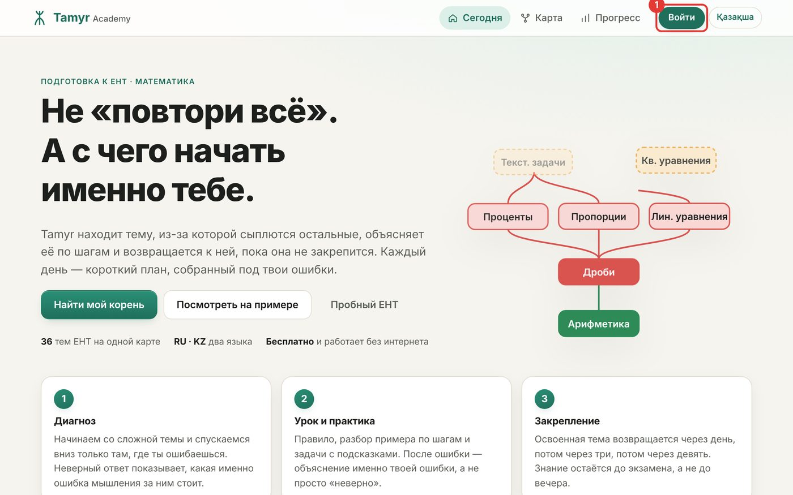

На экране входа нажмите **«Нет аккаунта? Создать»**, затем заполните форму:

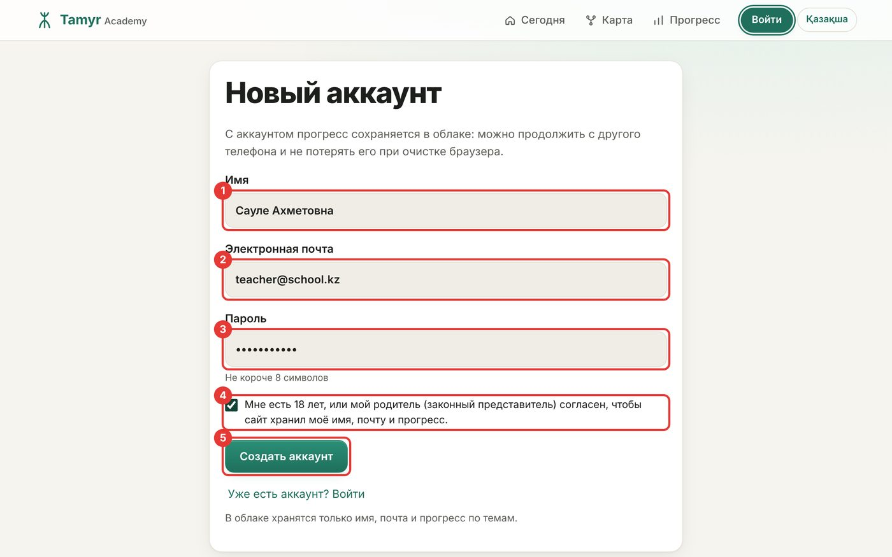

1. **Имя** — так вас увидят ученики, например «Сауле Ахметовна».
2. **Электронная почта.**
3. **Пароль** — не короче 8 символов.
4. Галочка согласия.
5. **«Создать аккаунт».**

Если придёт письмо со ссылкой, откройте его и перейдите по ссылке, чтобы подтвердить почту. Письмо может попасть в «Спам».

### Шаг 2.2. Получите роль учителя

Сразу после регистрации ваш аккаунт — **обычный, ученический**. Вкладку «Учителю» ученики не видят, и назначить себя учителем самостоятельно нельзя. Так ученик не сможет открыть чужие данные.

👉 **Отправьте администратору Tamyr (команде проекта) почту, с которой вы зарегистрировались.** Он включит роль учителя. После этого **обновите страницу**, и наверху появится вкладка **«Учителю»**. Теперь после каждого входа вы будете попадать сразу в панель учителя.

> **Пример.** «Здравствуйте! Я учитель математики 11 «А», школа № 25. Прошу включить роль учителя для saule.teacher@mail.kz».

---

## 3. Создать класс

Откройте вкладку **«Учителю»**. Пока своего класса нет, в панели показан **демо-класс** из 24 виртуальных учеников. Это симуляция: на ней можно посмотреть, как выглядит панель.

В блоке **«Мои классы»** впишите название класса, например `11 «А»`, и нажмите **«Создать класс» (1)**.

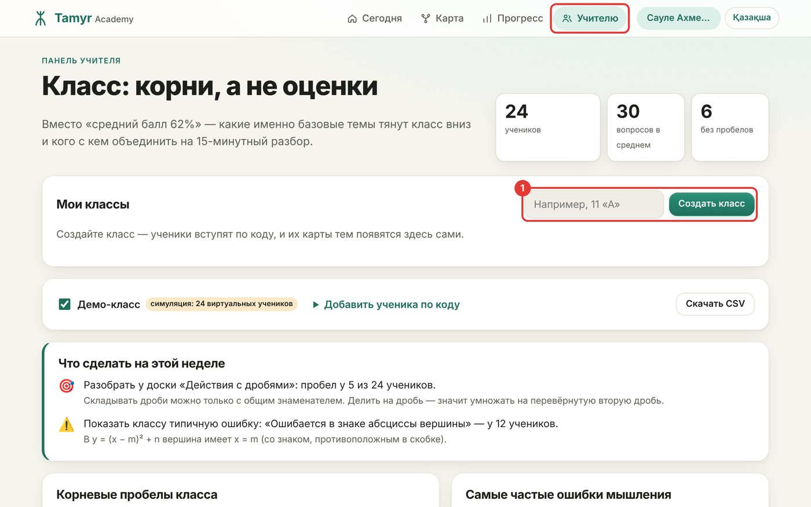

Tamyr сразу выдаст **код класса** из 6 знаков **(1)** и **ссылку** для приглашения **(2)**:

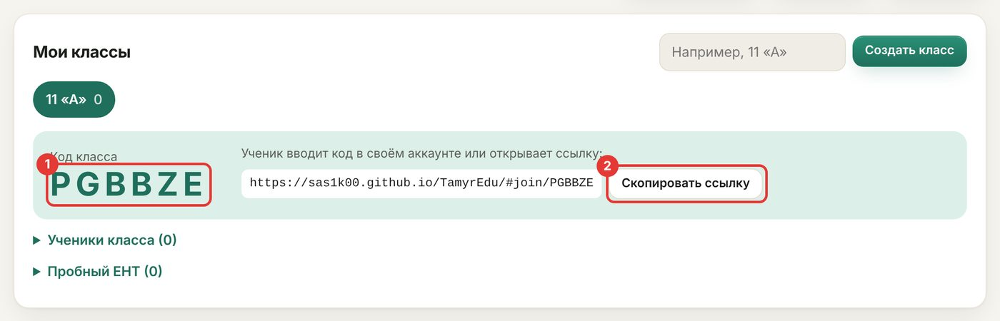

- **Код** удобно написать на доске, например `PGBBZE`. В кодах нет похожих символов вроде 0/O и 1/I/L, поэтому ученики их не перепутают.
- **Ссылку** удобно отправить в WhatsApp или Telegram-чат класса: нажмите **«Скопировать ссылку»** и вставьте её в чат.

Если у вас несколько классов, создайте каждый отдельно. Сверху появятся вкладки классов, например `11 «А» 6` (число — сколько учеников вступило). Нажмите на вкладку, чтобы переключиться.

---

## 4. Подключить учеников к классу

Ученику нужен **свой аккаунт** — без него учитель не увидит его прогресс. Это займёт у ученика около 2 минут.

**Что сказать классу** (можно прочитать вслух):

> «Откройте ссылку из чата (или сайт sas1k00.github.io/TamyrEdu). Нажмите „Войти“ → „Нет аккаунта? Создать“. Впишите своё **настоящее имя и фамилию**, чтобы я вас узнал(а). Потом в разделе „Мой класс“ введите код с доски и нажмите „Вступить“.»

Как это выглядит у ученика на телефоне:

<p>
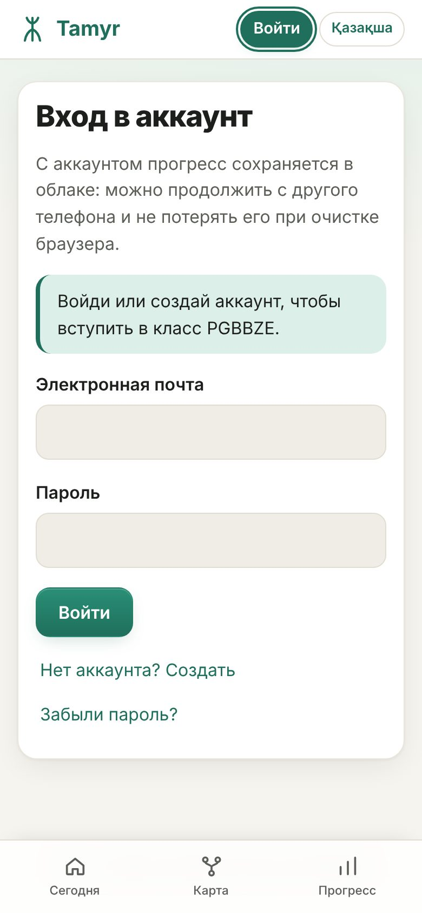
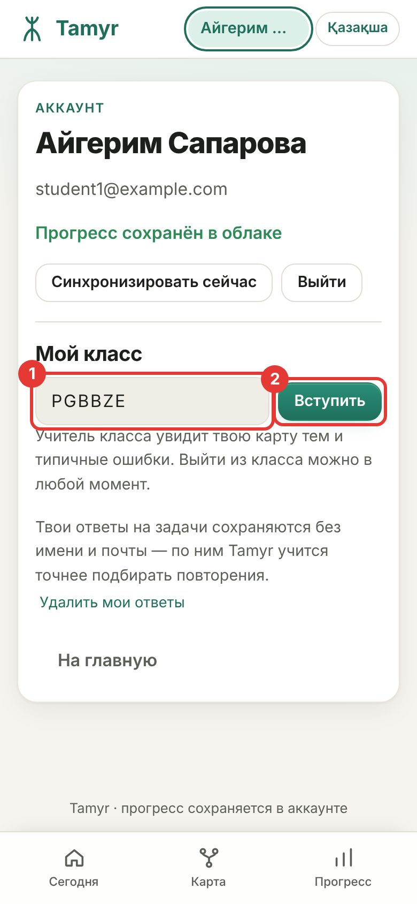
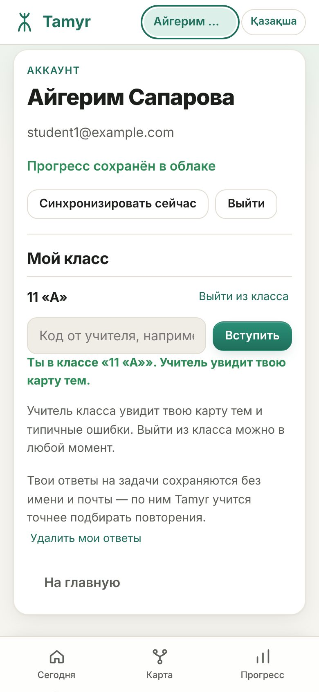
</p>

1. **Слева.** Ученик открыл ссылку класса. Tamyr просит войти или создать аккаунт и сам запоминает код класса.
2. **В центре.** После регистрации код уже вписан в поле **(1)**, осталось нажать **«Вступить» (2)**. Если ученик пришёл не по ссылке, он вводит код сам: значок с именем вверху → «Мой класс».
3. **Справа.** Готово: «Ты в классе «11 «А»». Учитель увидит твою карту тем».

Ученику прямо написано, что учитель видит его карту тем и типичные ошибки и что выйти из класса можно в любой момент.

**Проверка у учителя.** В панели раскройте **«Ученики класса»**. Там список всех, кто вступил. Пометка «ещё нет прогресса» означает, что ученик вступил, но ещё не начал диагностику.

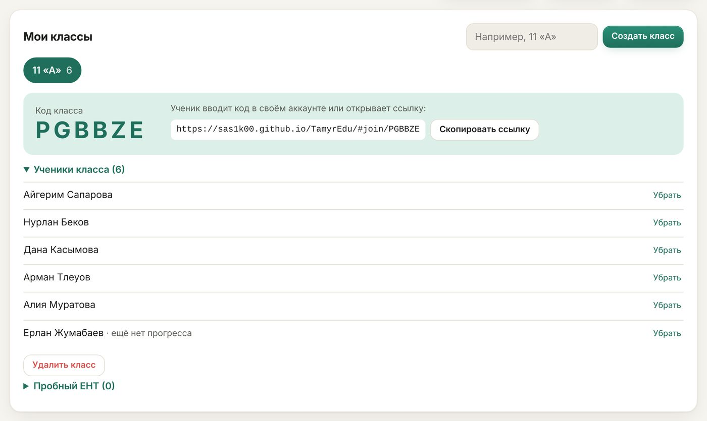

> Новые ученики появляются в панели не мгновенно: панель обновляется при открытии, но не чаще раза в минуту. Если кого-то не видно, **обновите страницу** (F5).

---

## 5. Ученики проходят диагностику

**Диагностика** — это короткий адаптивный тест. Он начинается со сложной темы. Если ученик ошибается, тест спускается к темам, на которых она держится, и ищет корень. Если ученик уверенно решает сложную тему, всё, что под ней, засчитывается без вопросов.

**Сколько времени.** Ученику без пробелов хватает около 10 вопросов, ученику с пробелами — до 30–40. На практике закладывайте **15–25 минут урока**.

<p>
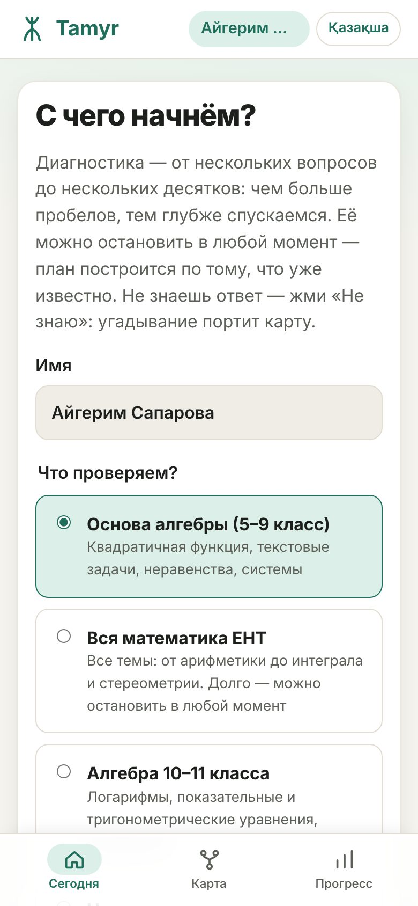
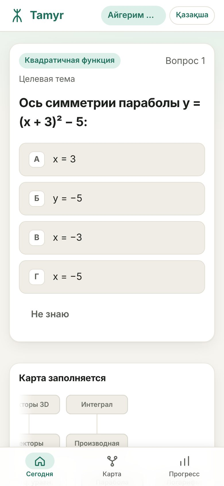
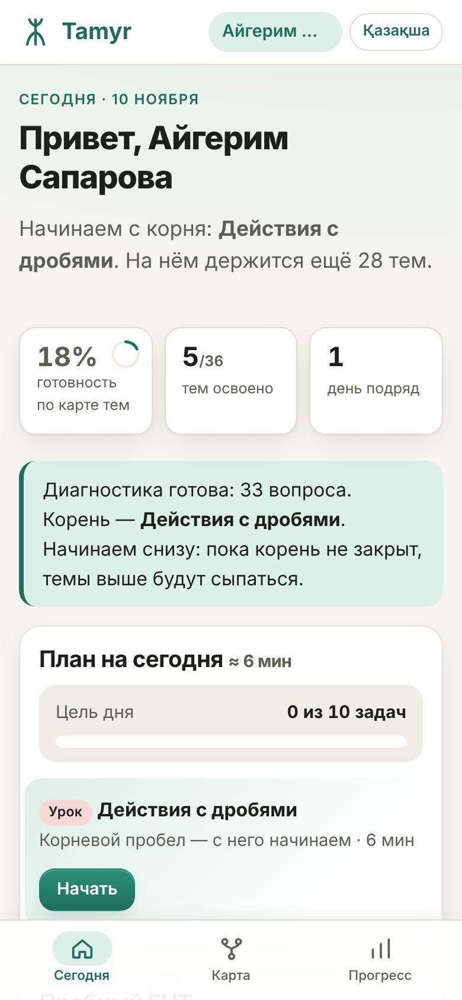
</p>

1. **«С чего начнём?»** Ученик выбирает, что проверять (обычно оставляем «Основа алгебры (5–9 класс)»), и нажимает **«Начать»** внизу.
2. **Вопрос.** 4 варианта ответа и кнопка **«Не знаю»**.
3. **Результат.** «Начинаем с корня: **Действия с дробями**». Дальше у ученика каждый день свой план: урок по корню, практика, повторения.

**Три важных правила для учеников** (скажите их до начала):

- **Не угадывать.** Не знаешь — жми «Не знаю». Угаданный ответ портит карту: Tamyr решит, что тема освоена, и пропустит настоящий пробел.
- **Не помогать друг другу и не списывать.** Иначе учитель получит неправильную картину класса.
- Диагностику **можно прервать**: после 6 вопросов появляется кнопка «Хватит, показать план», а незаконченная диагностика сохраняется до следующего раза. Лучше всё же пройти её до конца.

---

## 6. Как читать панель учителя

После диагностики данные учеников сами появляются во вкладке **«Учителю»**. Разберём панель сверху вниз на примере класса 11 «А» из 6 учеников: пятеро прошли диагностику, один ещё нет.

### 6.1. Сводка

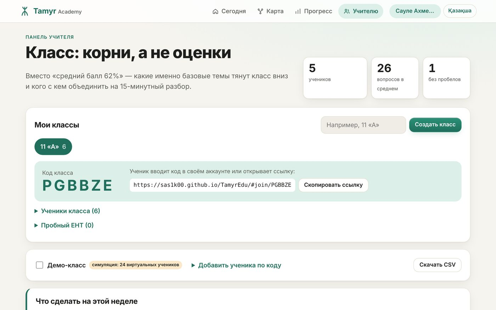

Три числа справа вверху:
- **учеников** — сколько учеников с данными сейчас в панели;
- **вопросов в среднем** — сколько вопросов в среднем ответил каждый;
- **без пробелов** — у скольких учеников не найдено ни одного корневого пробела.

### 6.2. «Что сделать на этой неделе» — начинайте отсюда

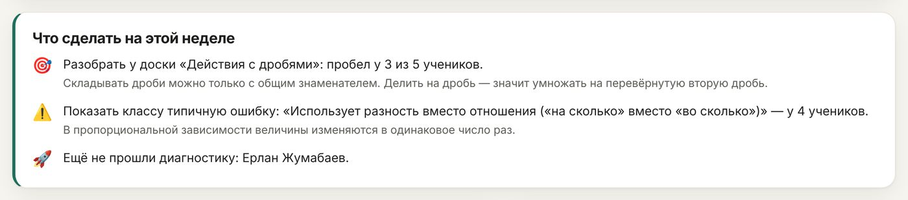

Это готовые действия, которые Tamyr собрал из данных класса:

| Значок | Что значит | Когда появляется |
|---|---|---|
| 🎯 | **Разобрать у доски** тему, которая чаще всего оказывается корнем. Под ней — правило, которое стоит повторить. | Пробел у 20 % класса и больше (минимум у двух учеников) |
| ⚠️ | **Показать классу типичную ошибку мышления** и как её исправить | Одна и та же ошибка у двух учеников и больше |
| ⏰ | **Напомнить** тем, кто давно не занимался | Ученик не занимался 3 дня и больше |
| 🚀 | **Кто ещё не прошёл диагностику** | Ученик вступил, но не начал |

**Пример из снимка.** У 3 из 5 учеников корень — «Действия с дробями». Значит, на следующем уроке стоит потратить 10 минут на дроби, даже если по программе сейчас квадратные уравнения. Ерлану Жумабаеву нужно напомнить пройти диагностику.

### 6.3. Корневые пробелы и ошибки мышления

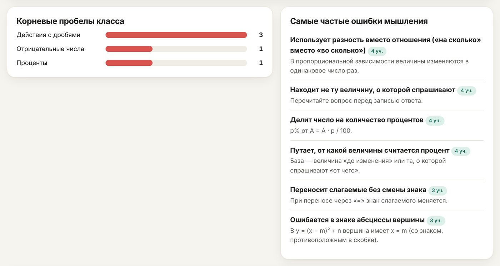

- **Корневые пробелы класса (слева).** Сколько учеников «застряли» на каждой базовой теме. Длинная полоса — тема для всего класса, короткая — для 1–2 учеников индивидуально.
- **Самые частые ошибки мышления (справа).** Конкретные неверные приёмы, которые Tamyr распознал по выбранным неверным ответам. Например, «Делит дроби „поперёк“, как при умножении — 3 уч.». Под каждой ошибкой одной строкой написано, как её исправить. Эту строку можно сказать классу дословно.

### 6.4. Мини-группы для разбора

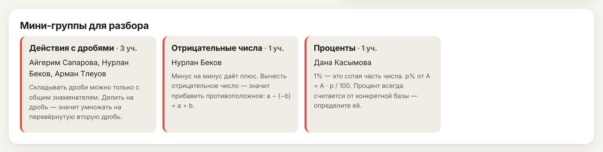

Tamyr сам делит класс на группы по корневому пробелу: кого с кем посадить на 15-минутный разбор и какое правило объяснить.

**Пример.** Пока класс решает самостоятельную, вы садитесь с группой «Действия с дробями» (Айгерим, Нурлан, Арман) и 15 минут разбираете с ними одно правило. Ученик может оказаться в двух группах, как Нурлан (дроби и отрицательные числа). Тогда начинайте с той темы, что ниже по программе.

### 6.5. Тепловая карта «ученик × тема»

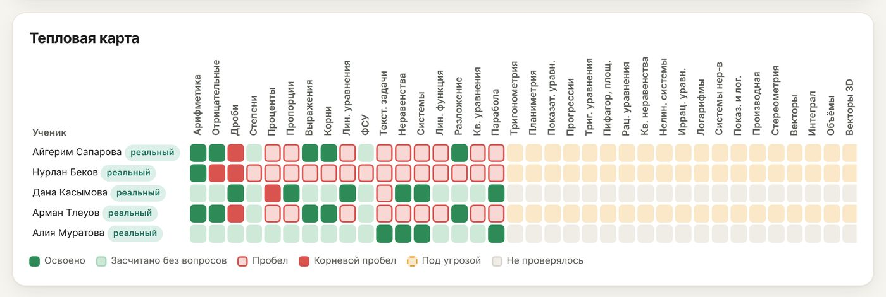

Каждая строка — ученик, каждый столбец — тема (слева базовые темы, справа темы старших классов). Цвета:

| Цвет | Значит | Что делать |
|---|---|---|
| Тёмно-зелёный — **Освоено** | Ученик решил задачи по теме | Ничего |
| Светло-зелёный — **Засчитано без вопросов** | Ученик решил более сложную тему, поэтому эта засчитана автоматически | Ничего |
| Розовый с красной рамкой — **Пробел** | Ошибки по теме | Ждёт, пока закроется корень |
| Ярко-красный — **Корневой пробел** | Самая низкая тема, на которой ученик ошибается. **Причина** остальных пробелов | **Начинать с неё** |
| Жёлтый с пунктиром — **Под угрозой** | Не проверялась, но держится на пробеле. Скорее всего, тоже «посыплется» | Вернуться после корня |
| Серый — **Не проверялось** | Данных пока нет | — |

**Как читать на примере.** У Нурлана Бекова два красных квадрата: «Отрицательные» и «Дроби». Почти вся строка розовая, а справа жёлтая. Значит, нет смысла гонять его по квадратным уравнениям, пока не закрыты отрицательные числа и дроби. У Алии Муратовой вся строка зелёная: ей можно давать задачи посложнее.

Наведите мышь на клетку — появится подсказка с темой и статусом. На телефоне карту можно прокручивать вбок.

### 6.6. Демо-класс

Переключатель **«Демо-класс» (1)** показывает или прячет 24 виртуальных ученика. Когда появляется настоящий класс, демо выключается само. **Не путайте:** у настоящих учеников в тепловой карте стоит пометка «реальный».

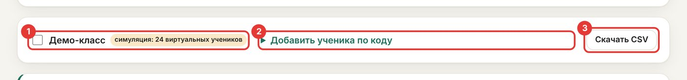

---

## 7. Записать результаты пробного ЕНТ

Если класс писал **пробный ЕНТ на бумаге или в другой системе**, внесите результаты в Tamyr. По ним команда проверяет, правильно ли Tamyr находит пробелы: темы, которые Tamyr назвал пробелом, должны чаще давать ошибки и на ЕНТ. **Ученики эти данные не видят.**

### Шаг 7.1. Откройте раздел

Под кодом класса раскройте **«Пробный ЕНТ»** и нажмите **«Внести пробный ЕНТ» (1)**.

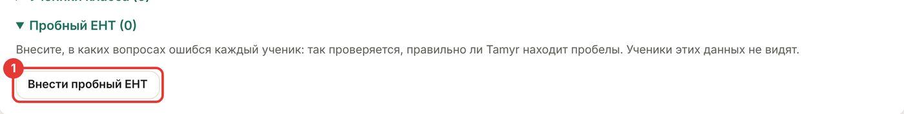

### Шаг 7.2. Название, дата и тема каждого вопроса

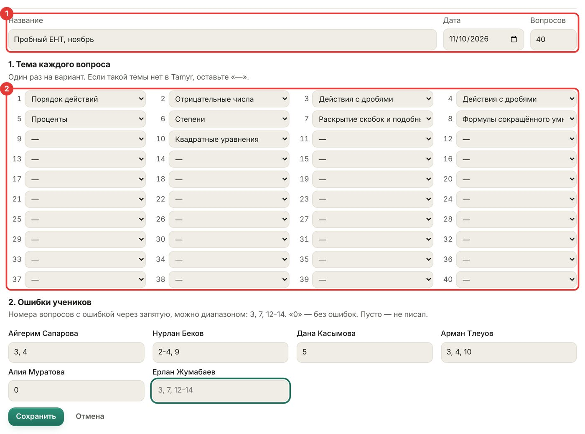

1. **Название** (например, «Пробный ЕНТ, ноябрь»), **дата** и **количество вопросов** (по умолчанию 40, можно от 1 до 80).
2. **Тема каждого вопроса.** Для каждого номера выберите тему из списка. Это делается **один раз на вариант**. Если в Tamyr нет подходящей темы (например, задача с чертежом), оставьте «—».

> **Пример.** В варианте вопрос 3 — «Вычислите 2/3 : 4/5». Выбираем «Действия с дробями». Вопрос 10 — «Решите x² − 5x + 6 = 0». Выбираем «Квадратные уравнения».

### Шаг 7.3. Ошибки каждого ученика

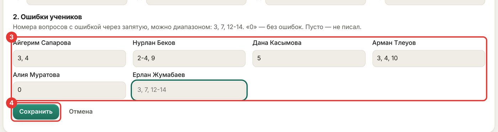

Рядом с именем каждого ученика **(3)** впишите **номера вопросов, где он ошибся**:

| Что вписать | Что значит |
|---|---|
| `3, 4` | Ошибся в вопросах 3 и 4 |
| `2-4, 9` | Ошибся в вопросах 2, 3, 4 и 9 (через дефис — подряд) |
| `0` | Написал **без ошибок** |
| *(пусто)* | **Не писал** этот пробный ЕНТ |

Нажмите **«Сохранить» (4)**. Если номер вписан неправильно (например, `45` при 40 вопросах или буквы), Tamyr покажет, у какого ученика проверить номера, и ничего не сохранит.

### Шаг 7.4. Готово

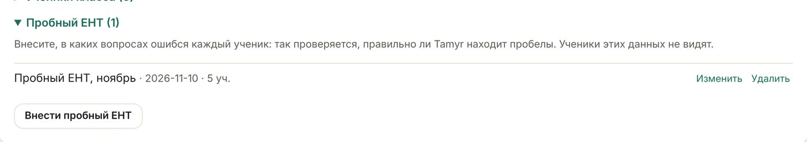

Пробный ЕНТ появился в списке: название, дата и сколько учеников внесено. **«Изменить»** — исправить ошибку или дописать ученика. **«Удалить»** — нужно нажать дважды (второй раз — «Точно удалить?»).

> В списке есть только ученики, которые **уже вступили в класс**. Если ученика нет — сначала подключите его (раздел 4), потом нажмите «Изменить».

---

## 8. Выгрузить данные в Excel

Кнопка **«Скачать CSV» (3)** на панели инструментов (см. снимок в разделе 6.6) скачивает файл `tamyr-class.csv`. Он открывается в Excel двойным кликом, кириллица читается нормально.

В файле: имя ученика, статус по каждой теме, список корневых пробелов и сколько вопросов он ответил. Статусы записаны английскими кодами:

| Код в файле | Значит |
|---|---|
| `mastered` / `solid` | Освоено / закреплено |
| `inferred` | Засчитано без вопросов |
| `learning` | Изучает сейчас |
| `gap` | Пробел |
| `risk` | Под угрозой |
| `unknown` | Не проверялось |

> Если включён демо-класс, его виртуальные ученики тоже попадут в файл. Перед выгрузкой снимите галочку «Демо-класс».

---

## 9. Если у ученика нет аккаунта: добавить по коду

Ученик может пользоваться Tamyr **без регистрации**: прогресс тогда хранится только на его телефоне. Чтобы учитель его увидел, ученик передаёт **код**.

<p>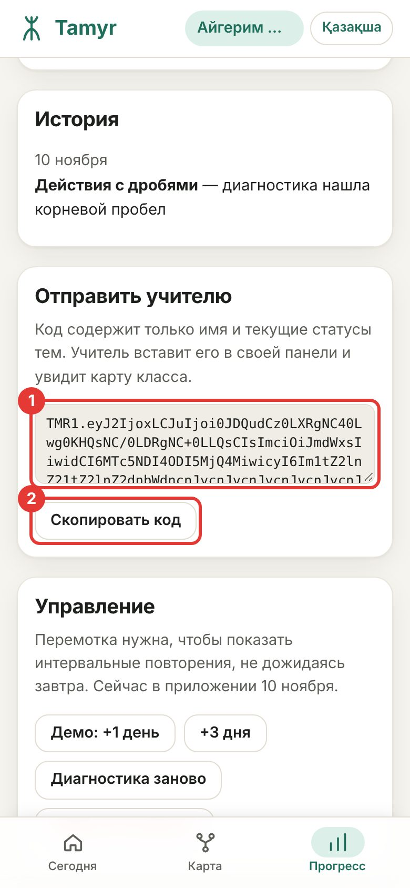</p>

**У ученика:** вкладка **«Прогресс»** → блок **«Отправить учителю»** → **«Скопировать код» (2)** → отправить код учителю в чат. Код начинается с `TMR1.` **(1)**.

**У учителя:** в панели раскройте **«Добавить ученика по коду»**, вставьте код **целиком** и нажмите **«Добавить»**.

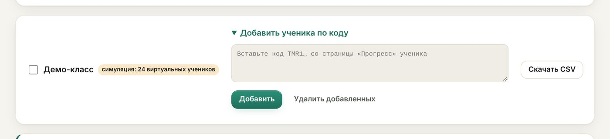

Чем этот способ хуже, чем класс:
- код — это снимок **на момент копирования**. Новые успехи ученика в панели не появятся, пока он не пришлёт новый код;
- добавленные ученики хранятся **только в этом браузере** на вашем компьютере. На другом компьютере их не будет;
- «Что сделать на этой неделе» не может напомнить таким ученикам, что они давно не занимались.

Поэтому для постоянной работы лучше класс с кодом (раздел 3–4). Способ с кодом подходит для разовой проверки.

---

## 10. Управление классом

Всё делается в блоке **«Мои классы»** → **«Ученики класса»** (снимок в разделе 4).

| Задача | Как |
|---|---|
| Убрать ученика из класса | «Убрать» напротив имени → «Точно убрать?» |
| Удалить класс целиком | «Удалить класс» внизу списка → «Точно удалить класс…?» |
| Второй класс | Новое название → «Создать класс». Переключение — вкладками классов |
| Ученик сам вышел из класса | Это его право: он исчезнет из списка. Попросите вступить снова по тому же коду |
| Ученик перешёл в другой класс | Уберите его из старого, он вступит по коду нового |

Удалённого ученика или класс вернуть кнопкой нельзя, но прогресс самого ученика **не удаляется**: он хранится в его аккаунте. Если ученик снова вступит по коду, его данные снова появятся в панели.

---

## 11. Пример: одна неделя с Tamyr

| День | Что делаем | Время |
|---|---|---|
| **Понедельник** | Создать класс, написать код на доске. Ученики регистрируются, вступают и проходят диагностику | 25 мин урока |
| **Понедельник, вечер** | Открыть панель → «Что сделать на этой неделе». Записать главный корень класса и мини-группы | 10 мин |
| **Вторник** | В начале урока разобрать у доски тему 🎯 и ошибку ⚠️. Строку «как исправить» из панели можно сказать классу дословно | 10 мин урока |
| **Среда–четверг** | Пока класс решает самостоятельную, 15 минут работать с одной мини-группой | 15 мин урока |
| **Каждый день, дома** | Ученики открывают «Сегодня» и проходят свой план: урок по корню, практика, повторения (около 10 задач, ~15 минут) | дома |
| **Пятница** | Открыть тепловую карту: стало ли больше зелёного? Кому из ⏰ напомнить? | 5 мин |
| **После пробного ЕНТ** | Внести результаты (раздел 7) | 15–20 мин на класс |

---

## 12. Частые вопросы и проблемы

**Нет вкладки «Учителю».**
Роль учителя ещё не включена (раздел 2.2), или вы не обновили страницу после того, как её включили. Также проверьте, что вы вошли под той же почтой, которую отправили администратору.

**Ученик вступил, но его нет в панели / он «ещё нет прогресса».**
Ученик ещё не прошёл диагностику, или панель не обновилась: нажмите F5. Прогресс уходит в облако через пару секунд после ответа, без интернета — когда связь вернётся.

**«Класс с таким кодом не найден».**
Ученик ошибся в коде. Проверьте, что в коде 6 знаков и что ученик вводит код **вашего** класса. Проще всего отправить ссылку в чат.

**Ученик зарегистрировался под ником («Котик2008»).**
В панели будет видно это имя. Попросите ученика выйти и создать аккаунт с настоящим именем, либо запомните, кто есть кто.

**Ученик прошёл диагностику «слишком хорошо» / результат странный.**
Возможно, он угадывал или ему подсказывали. Попросите его на «Прогрессе» нажать «Диагностика заново» и пройти её честно, с «Не знаю».

**Ученик потерял прогресс.**
Если он был **без аккаунта**, прогресс хранился только в браузере и пропал при очистке. С аккаунтом прогресс в облаке: достаточно снова войти.

**Можно ли пользоваться с телефона?**
Да. Ученикам — именно с телефона. Учителю панель тоже открывается на телефоне, но тепловую карту удобнее смотреть на компьютере.

**Видят ли ученики оценки друг друга?**
Нет. Ученик видит только свой прогресс. Данные класса видит только учитель этого класса, и только пока у него есть роль учителя.

---

## 13. Честно: чего Tamyr пока не умеет

Лучше знать заранее:

- **Это не прогноз балла ЕНТ.** «Готовность» — это доля освоенных тем на карте, а не обещанный балл. Задачи базового уровня, без чертежей.
- **Темы — алгебра и основы ЕНТ по математике.** 36 тем: от порядка действий до интеграла, векторов и стереометрии. Геометрия с чертежами и сложные задачи пока не покрыты.
- **Уроки, решения и казахский перевод написаны с помощью ИИ.** Учитель их ещё не вычитывал. Если заметите ошибку в задаче или переводе, сообщите команде, это очень поможет.
- **Пороги** («3 верных подряд без подсказок», когда возвращать тему на повторение) выбраны командой и пока не проверены на реальных учениках. Модель повторений стандартная, она не настроена под наших учеников.
- **Результаты пробного ЕНТ пока не превращаются в графики** в панели. Они нужны, чтобы проверить точность Tamyr. Ваши внесённые данные — главный способ сделать его точнее.
- **Tamyr не заменяет учителя.** Он показывает, *где* корень и *кого* с кем объединить. Объяснить так, чтобы поняли, можете только вы.

---

## 14. Шпаргалка на одну страницу

```
УЧИТЕЛЬ — один раз
  1. sas1k00.github.io/TamyrEdu → «Войти» → «Нет аккаунта? Создать»
  2. Отправить почту администратору → получить роль → обновить страницу
  3. «Учителю» → «Мои классы» → название → «Создать класс»
  4. Код — на доску, ссылку — в чат класса

УЧЕНИК — один раз (2 минуты)
  1. Открыть ссылку → «Нет аккаунта? Создать» (настоящее имя!)
  2. «Мой класс» → код → «Вступить»
  3. «Найти мой корень» / «Начать» → диагностика (не угадывать, жать «Не знаю»)

УЧИТЕЛЬ — каждую неделю
  • «Что сделать на этой неделе»: 🎯 разобрать у доски, ⚠️ показать ошибку,
    ⏰ напомнить, 🚀 кто не начал
  • «Мини-группы»: с кем сесть на 15 минут
  • Тепловая карта: красный = корень → начинать с него

ПОСЛЕ ПРОБНОГО ЕНТ
  «Пробный ЕНТ» → «Внести» → темы вопросов (один раз на вариант)
  → ошибки учеников: «3, 7, 12-14», «0» = без ошибок, пусто = не писал → «Сохранить»
```
